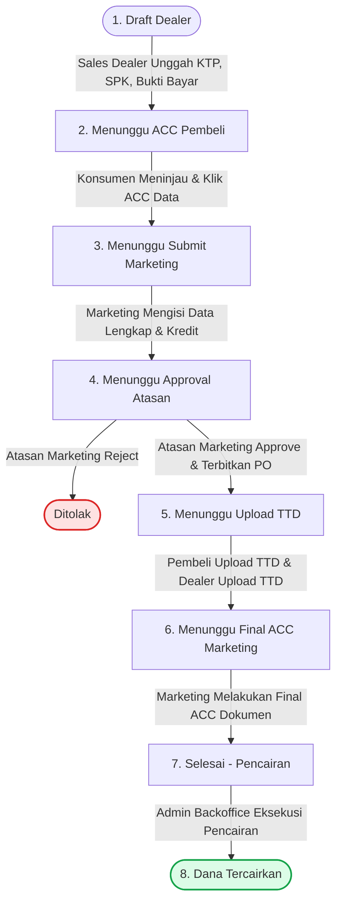

# 🚗 PT JKL – Auto Finance Flow

<div align="center">

[](https://vagrantassassin.github.io/bca-auto-finance-flow/)
[](https://react.dev)
[](https://www.typescriptlang.org/)
[](https://tanstack.com)
[](https://tailwindcss.com)
[](https://vitest.dev)

### **Sistem Simulasi Pengajuan Kredit Kendaraan Bermotor (End-to-End)**

🌐 **Akses Website Live:**  
👉 **[https://vagrantassassin.github.io/bca-auto-finance-flow/](https://vagrantassassin.github.io/bca-auto-finance-flow/)**

</div>

---

## 📌 Tentang Proyek

**PT JKL Auto Finance Flow** adalah aplikasi web simulasi bisnis (*Single Page Application*) yang merepresentasikan siklus penuh (**End-to-End**) proses pengajuan kredit kendaraan bermotor pada **PT JKL**. 

Aplikasi ini dirancang dengan gaya antarmuka korporat (*Corporate Blue & Clean White*), dilengkapi sistem transisi status terintegrasi (*Finite State Machine*), simulasi tanda tangan dokumen digital (*dual-party digital signature*), pencetakan *Purchase Order* (PO) otomatis, serta fitur **Role Switcher** instan tanpa autentikasi rumit agar siap digunakan untuk kebutuhan demo, verifikasi alur, maupun presentasi stakeholder bisnis.

---

## 🛠️ Teknologi & Arsitektur Sistem

Aplikasi ini dibangun menggunakan arsitektur modern berbasis TypeScript dan Vite:

| Kategori | Teknologi | Deskripsi / Peran |
| :--- | :--- | :--- |
| **Framework & Runtime** | [React 19](https://react.dev) + [TanStack Start](https://tanstack.com/start) | Framework fullstack modern dengan performa tinggi & SSR/static capabilities |
| **Bahasa Pemrograman** | [TypeScript 5.8](https://www.typescriptlang.org/) | Type-safe end-to-end untuk seluruh entitas bisnis dan status alur |
| **Routing** | [TanStack Router](https://tanstack.com/router) | Routing berbasis tipe data dengan dukungan subfolder deployment |
| **Styling & Design System** | [Tailwind CSS v4](https://tailwindcss.com) + OKLCH Colors | Sistem tema perbankan korporat dengan tipografi modern *IBM Plex Sans* |
| **Komponen Antarmuka** | [Radix UI](https://www.radix-ui.com/) (shadcn/ui pattern) | Primitif UI aksesibel: Dialog/Modal, Table, Badge, Card, Button, Form Inputs |
| **Manajemen Status & State** | React State + `localStorage` | Reaktif instan, data bertahan saat reload browser (*zero external database*) |
| **Automated Testing** | [Vitest](https://vitest.dev) + Testing Library | Validasi routing, inisialisasi state, dan integritas antarmuka |
| **CI / CD & Deployment** | GitHub Actions + GitHub Pages | Pipeline otomatis untuk build static prerendering & deployment dengan Bun |

---

## 🔄 Alur Proses Bisnis & State Machine

Siklus pengajuan kredit kendaraan bermotor bergerak mengikuti diagram alur berikut:



---

## 👥 Fitur Berdasarkan 5 Role Pengguna

Di bilah atas (*header*) aplikasi terdapat dropdown **"Login As"** untuk berganti peran secara langsung:

### 1. 🏢 Sales Dealer
* **Tabel Pengajuan:** Melihat semua pengajuan yang diajukan oleh dealer.
* **Buat Pengajuan Baru:** Formulir input Nama Konsumen beserta simulasi unggah dokumen wajib:
  * File KTP Konsumen (`.pdf`)
  * Dokumen SPK (Surat Pemesanan Kendaraan)
  * Bukti Pembayaran Uang Tanda Jadi (*Booking Fee*)
* **Upload TTD Dealer:** Melakukan tanda tangan digital dealer saat memasuki tahap penandatanganan PO.

### 2. 👤 Pembeli (Konsumen)
* **Verifikasi Data Awal:** Meninjau kelengkapan dokumen yang diinput oleh dealer dan menekan **"Lihat Data & ACC"**.
* **Upload TTD Konsumen:** Menandatangani berkas persetujuan pembiayaan setelah nomor PO diterbitkan.

### 3. 👔 Marketing
* **Lengkapi Data Kredit:** Menginput informasi komprehensif:
  * **Data Pribadi:** NIK (validasi 16 digit), Tanggal Lahir, Status Pernikahan.
  * **Data Kendaraan:** Merk, Tipe, Warna, Harga OTR.
  * **Data Pinjaman:** Uang Muka (DP), Tenor (12, 24, 36, 48, 60 bulan), Jenis Asuransi (*All Risk*, *Total Loss Only*, *Kombinasi*).
  * **Kalkulasi Otomatis:** Perhitungan otomatis pokok hutang pembiayaan (`Harga OTR - DP`).
* **Final ACC Dokumen:** Memeriksa kelengkapan tanda tangan kedua belah pihak dan mengesahkan berkas ke tahap pencairan.

### 4. 🎖️ Atasan Marketing
* **Review Kelayakan:** Meninjau seluruh rekapitulasi data konsumen, data unit kendaraan, dan skema pembiayaan.
* **Keputusan Approval:**
  * **Approve & Generate PO:** Otomatis menerbitkan nomor Surat Purchase Order resmi (`PO/JKL/YYYY/XXXXXX`).
  * **Reject:** Menolak pengajuan kredit (status berubah menjadi *Ditolak*).

### 5. 🏛️ Admin Backoffice
* **Pratinjau Dokumen PO Resmi:** Membuka cetakan teks formal Purchase Order PT JKL dengan rincian klausul persetujuan.
* **Eksekusi Pencairan Dana:** Menyelesaikan proses transaksi keuangan; baris data otomatis ditandai hijau terang (*Tercairkan*).

---

## 🧪 Panduan Skenario Pengujian (Testing / Demo Walkthrough)

Anda dapat menguji seluruh alur bisnis dari awal sampai akhir hanya dalam waktu 2 menit dengan skenario berikut:

```text
[Langkah 1: Sales Dealer]
1. Buka website https://vagrantassassin.github.io/bca-auto-finance-flow/
2. Pastikan role pada dropdown adalah "Sales Dealer".
3. Klik tombol "+ Buat Pengajuan Baru".
4. Masukkan Nama Konsumen (contoh: "Ahmad Dahlan").
5. Klik tombol "Upload" pada KTP, SPK, dan Bukti Bayar.
6. Klik "Submit ke Pembeli". Status menjadi "Menunggu ACC Pembeli".

[Langkah 2: Pembeli]
7. Ubah dropdown role menjadi "Pembeli".
8. Pada baris data pengajuan tadi, klik tombol "Lihat Data & ACC".
9. Periksa ringkasan berkas, lalu klik "ACC Data". Status berubah ke "Menunggu Submit Marketing".

[Langkah 3: Marketing]
10. Ubah dropdown role menjadi "Marketing".
11. Klik tombol "Lengkapi Data".
12. Isi NIK (16 digit), Tanggal Lahir, Merk (misal: "Honda"), Tipe ("HR-V SE"), Warna ("Putih"), Harga OTR (misal: "400000000"), DP ("100000000").
13. Klik "Submit ke Atasan". Status berubah ke "Menunggu Approval Atasan".

[Langkah 4: Atasan Marketing]
14. Ubah dropdown role menjadi "Atasan Marketing".
15. Klik tombol "Review", periksa data pembiayaan dan pokok hutang.
16. Klik tombol "Approve & Generate PO". Status berubah menjadi "Menunggu Upload TTD" dan nomor PO dibuat.

[Langkah 5: Tanda Tangan Dokumen (Dual Party)]
17. Ubah role ke "Pembeli" -> klik tombol "Upload TTD".
18. Ubah role ke "Sales Dealer" -> klik tombol "Upload TTD Dealer".
19. Begitu kedua pihak selesai mengunggah TTD, status otomatis naik menjadi "Menunggu Final ACC Marketing".

[Langkah 6: Finalisasi & Pencairan]
20. Ubah role ke "Marketing" -> klik tombol "Final ACC Dokumen". Status menjadi "Selesai (Pencairan)".
21. Ubah role ke "Admin Backoffice".
22. Klik "Lihat Dokumen PO" untuk membaca surat pembiayaan resmi.
23. Klik "Eksekusi Pencairan Dana". Baris tabel akan berubah hijau ("Tercairkan").
```

> 💡 **Tips Pengujian:**  
> Kapan saja Anda ingin memulai pengujian dari awal, klik tombol **"Reset Demo"** di bilah kanan atas.

---

## 💻 Pengujian Otomatis (Automated Testing)

Project ini dilengkapi dengan test suite otomatis menggunakan **Vitest**:

```bash
# Menjalankan unit test dan router check
npm run test
# atau dengan bun:
bun test

# Menjalankan test dalam mode watch
npm run test:watch
```

---

## 🚀 Menjalankan Proyek Secara Lokal

### Prasyarat
* [Node.js](https://nodejs.org/) (versi 18+) atau [Bun](https://bun.sh/) (versi 1.1+)

### Langkah Instalasi
```bash
# 1. Clone repository
git clone https://github.com/VagrantAssassin/bca-auto-finance-flow.git
cd bca-auto-finance-flow

# 2. Install dependensi
bun install
# atau
npm install

# 3. Jalankan server lokal development
bun run dev
# atau
npm run dev

# 4. Buka di browser
# http://localhost:3000 atau http://localhost:5173
```

### Build untuk Produksi
```bash
bun run build
# atau
npm run build
```

---

## 📂 Struktur Direktori Proyek

```text
bca-auto-finance-flow/
├── .github/
│   └── workflows/
│       └── deploy.yml             # Pipeline otomatis deploy ke GitHub Pages
├── src/
│   ├── components/
│   │   └── ui/                    # Primitif UI (Button, Dialog, Table, Badge, Card, dll.)
│   ├── lib/
│   │   ├── kredit.ts              # State machine, type interface, & data seed
│   │   └── utils.ts               # Helper class merging Tailwind (cn)
│   ├── routes/
│   │   ├── __root.tsx             # Root layout, HTML shell, meta tags, & fonts
│   │   └── index.tsx              # Main Dashboard, role views, & modal forms
│   ├── test/                      # Test suite aplikasi (Vitest)
│   ├── router.tsx                 # Konfigurasi TanStack Router & Basepath
│   ├── styles.css                 # Tema OKLCH, font IBM Plex Sans, Tailwind v4
│   └── start.ts                   # Entry point TanStack Start
├── vite.config.ts                 # Konfigurasi Vite & Prerender TanStack Start
└── package.json                   # Dependensi & script proyek
```

---

<div align="center">
  <sub>Dibangun untuk simulasi proses bisnis pembiayaan kendaraan bermotor terintegrasi.</sub>
</div>
